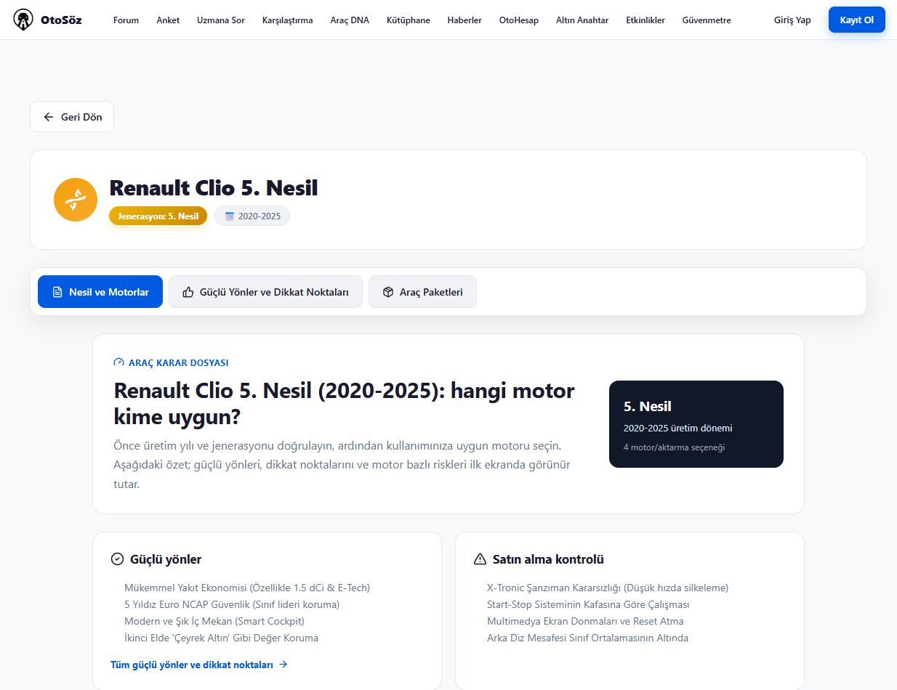

# Step 04 — Sunucu render ve istemci paketleri

Yerelde uygulandı ve doğrulandı. Canlıya dağıtılmadı. Ayrıntılı makine raporu: [step04-20261029.json](step04-20261029.json).

## Önce / sonra

| Model | Önce JS (bayt) | Sonra JS (bayt) | Azalma | Gzip (bayt) |
|---|---:|---:|---:|---:|
| Renault Clio 5 | 1,985,569 | 687,907 | 65.35% | 505,758 → 213,302 |
| Fiat Egea 1 | 1,985,569 | 687,907 | 65.35% | 505,758 → 213,302 |
| Toyota Corolla 12 | 1,985,569 | 687,907 | 65.35% | 505,758 → 213,302 |

Next 16.3 build tablosu route başına first-load byte sütunu sunmuyor. Aynı URL'lerin ilk HTTP HTML yanıtındaki benzersiz harici script ve script preload dosyaları ölçüldü; gzip aynı zlib ayarıyla hesaplandı. Sonradan oturum/etkileşim için yüklenen SDK'lar bu tanıma dahil değil. Tam 20 URL ölçümü: [önce](step04-before.txt), [sonra](step04-after.txt). Üç modelin ana metni sırasıyla 4131 / 2702 / 3791 karakter olarak korundu.

## Doğrulama

- Ayrı TypeScript kontrolü ve üretim build'i temiz; 1035 statik sayfa (önce 672).
- 21 test ve istemci import ESLint kontrolü geçti. 171 client girişinin transitif ağında yasak 5 katalog importu yok; 163 chunk içinde Clio eşleşmesi yok.
- JavaScript çalıştırmadan 694 HTML sayfası incelendi; kaynak metin/H1/ana içerik kontrolünde hata yok.
- 689 sitemap URL'sinin tamamı 200. Toplam 2371 URL'de robots/canonical/schema/durum tutarsızlığı yok.
- 231 durum kontrolü, 105 gerçek curl kontrolü, 37 hub ve 13 kalite kontrolü geçti.
- Googlebot curl ile Clio'nun iki kronik sorun başlığı script dışındaki HTML metninde bulundu. Canlıdaki aynı özel içerik kontrolü de geçti; canlı genel HTTP denetiminde eski sürüme ait 51 sapma sürüyor.
- Tarayıcıda 3 model, 2 motor, 4 sekme; marka/yıl araması, iki araç karşılaştırması, Piyasalar/Güvenmetre/Etkinlik filtreleri denetlendi. [Tarayıcı kaydı](step04-browser-check.json).

Komutlar ve sonuçları JSON raporunun validation.commands alanında.

## Açık riskler

Dağıtım yapılmadı; canlıya geçince HTTP ve paket ölçümleri yeniden çalıştırılmalı. Hesapla yapılan yazma işlemleri/oylar/yüklemeler denenmedi. Test taramalarında görülen Next Internal NoFallbackError günlükleri HTTP doğrulamalarını bozmadı; üretimde ISR günlükleri izlenmeli. Katalog iddialarının editoryal doğruluğu bu render adımının kapsamına girmiyor.

